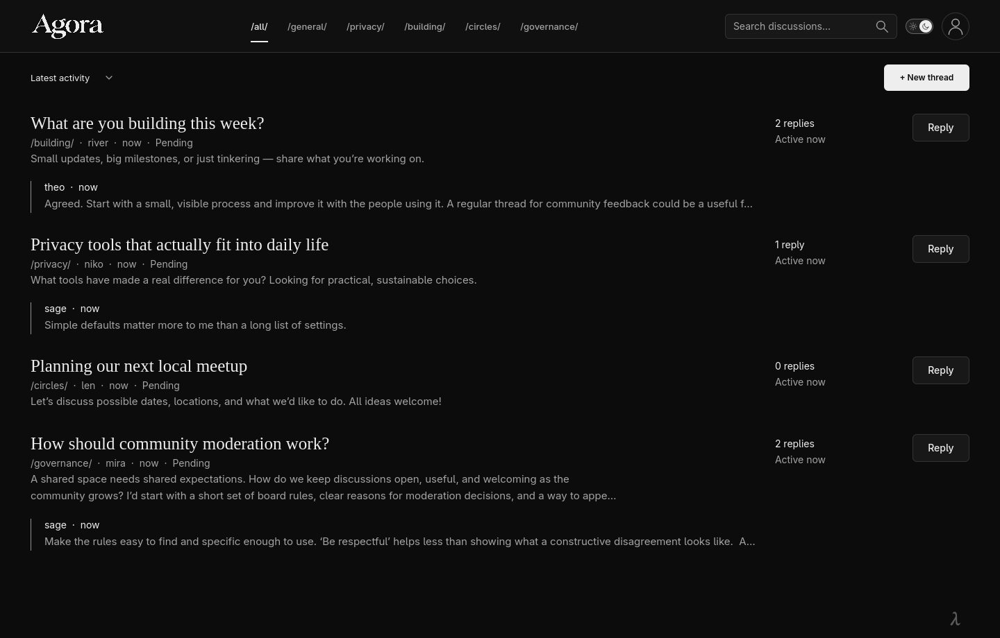
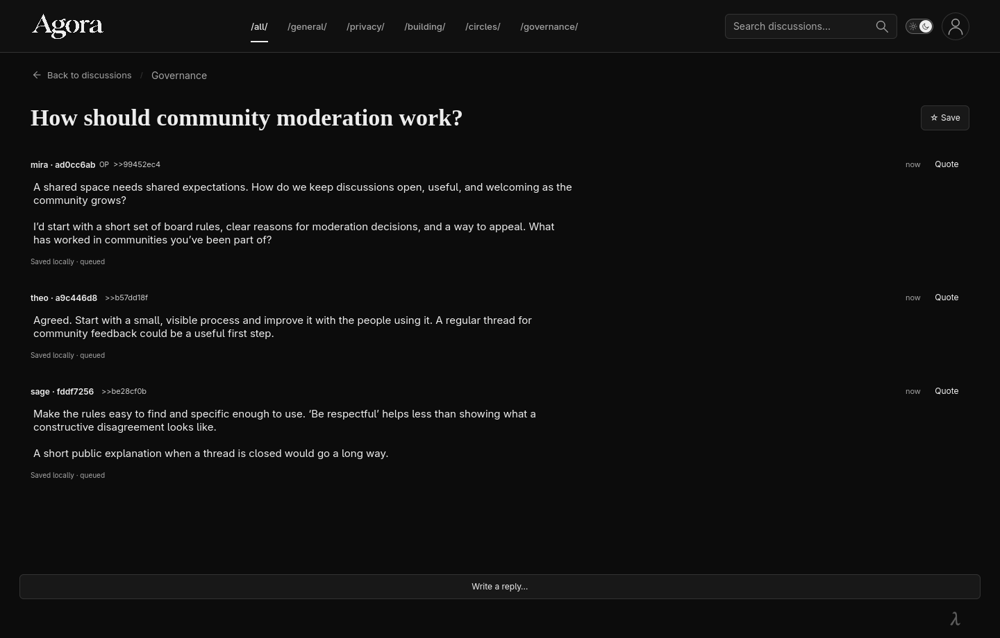

# Agora

A native, local-first forum for **Logos Basecamp**. Discussions, replies and shared media, built with **C++ · Qt/QML · SQLite** and no centralized application server.

[Download alpha](https://github.com/stevancarlon/logos-agora/releases) · [Demo](https://github.com/stevancarlon/logos-agora/releases/download/v0.3.2-alpha.1/agora-0.3.2-walkthrough.mp4) · [Install](INSTALL.md) · [Build from source](docs/GUIDE.md#build-and-test)

  
  

*Development preview · Sample discussions. Click to enlarge.*

## Features

- Boards, threads, replies, quotes and search.
- Multiple identities, aliases, anonymous display and identity rotation.
- Images, inline video and PDFs; sharing through Logos Storage.
- Local drafts and offline posting, with retry and history recovery through Logos Delivery.
- Dark and light themes.

## Get started

Download the kit for Linux, macOS or Windows and follow the [installation guide](INSTALL.md). Agora requires Basecamp and the matching media companion runtime. Shared attachments also require a local Logos Storage node.

Open **Agora** in Basecamp, choose an identity and start a thread. Agora connects to Logos Delivery automatically.

**Alpha:** packages are unsigned. Public Delivery receipt is verified between separate profiles on one Linux host; cross-machine messaging remains unverified. Anonymous display does not guarantee network anonymity; public posts are not end-to-end encrypted.

## Documentation

- [Usage and development](docs/GUIDE.md)
- [Network setup](docs/NETWORK.md) · [Storage setup](docs/STORAGE.md)
- [Architecture and protocol](docs/PROTOCOL.md)
- [Verification and limitations](docs/FURPS.md)

Native application source lives in `native/`. The earlier React prototype in `src/` is retained for reference.

## License

[MIT](LICENSE-MIT) OR [Apache-2.0](LICENSE-APACHE). Independent community project; no official Logos endorsement.
